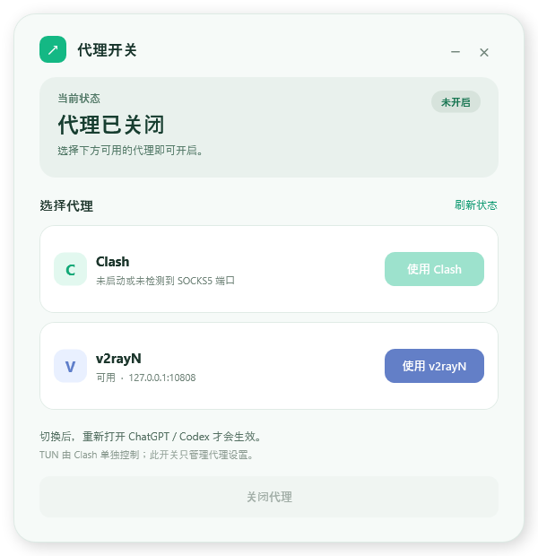

# ProxySwitch（代理开关）

个人使用的 Windows 图形开关：在 Clash Plus 和 v2rayN 之间选择当前可用的本地 SOCKS5 代理，并可一键删除本程序写入的代理配置。**这是非官方工具，与 OpenAI、Clash Plus、v2rayN 无关。**

## 下载与运行

在本仓库的 **Releases** 下载 `ProxySwitch.exe`，双击运行；也可以下载 ZIP 后解压运行。仓库为私有仓库，只有有权限的 GitHub 账号能访问下载页。

适用于 Windows 10/11 x64，使用系统自带的 Windows PowerShell 5.1 和 .NET Framework。EXE 包含界面与脚本，启动时将它们写入 `%LOCALAPPDATA%\ProxySwitch\0.1.0\src`。无需管理员权限，也不安装驱动。当前版本未签名。

## 使用

1. 先启动 Clash Plus 或 v2rayN，并确认客户端提供本地 SOCKS5 代理。
2. 打开 ProxySwitch。它只检查所选客户端进程拥有的监听口，并进行本地 SOCKS5 握手；找到**唯一**有效端口时才能点击相应按钮。
3. 选择客户端后，完全退出再打开 ChatGPT／Codex；已经运行的进程不会因切换而自动更新环境。
4. 不需要代理时点「关闭代理」。玩游戏前还要在 Clash 内**另行关闭 TUN**，并重开已运行的游戏启动器。

## 实际修改了什么

- 开启时写入当前 Windows **用户级** `HTTP_PROXY`、`HTTPS_PROXY`、`ALL_PROXY`，值为 `socks5h://127.0.0.1:<检测到的端口>`。
- 同时在 `%USERPROFILE%\.codex\.env` 写入有 `CODEX_PROXY_TOGGLE` 标记的受控区块。
- 关闭时删除本程序管理的上述三项用户变量及 `.env` 受控区块。保留原有用户 `NO_PROXY` 和 `.env` 的其他内容；遇到不认识的代理配置会拒绝覆盖。
- 不修改 Windows 系统代理、WinHTTP、机器级环境变量、TUN 或游戏配置。

**范围说明：**用户级环境变量可能影响开启后新启动的其他程序。它们也不能保证 Store 版 ChatGPT 的所有 WebSocket 或其他连接都走代理；本程序不是按进程强制代理工具，不能“打包全部流量”。若代理客户端关闭而开关仍开启，新程序可能连向失效端口，请及时点「关闭代理」。

## 构建

在 Windows PowerShell 5.1 中运行 `powershell.exe -NoProfile -ExecutionPolicy Bypass -File .\build.ps1`。这只对当前构建进程生效。脚本会将 PowerShell Gallery 的 `ps2exe` **1.0.18** 保存到本地 `.build-tools`，并生成 `dist/ProxySwitch.exe`、ZIP 和 SHA256 校验文件。`.build-tools`、`dist` 不进入 Git；发布包放到 GitHub Releases。

构建工具：[PS2EXE](https://github.com/MScholtes/PS2EXE)。生成的 EXE 是 PowerShell 宿主，源码仍可提取，并非原生重写或加密程序。

## 已知限制

- 端口发现依赖 Clash Plus 的 `MyClash.exe`／`MyClashCore.exe`，或 v2rayN 及其子进程。代理客户端更新进程结构后，可能需要更新检测逻辑。
- 若同一客户端有多个有效 SOCKS5 监听口，程序会拒绝自动选择。
- 切换只对新启动并且遵循这些变量的进程生效；不保证解决所有 ChatGPT／Codex 重连情况。
- 这是个人测试版；尚未完成关闭 TUN 后的长期桌面连接与游戏登录回归。

## 文件

- `src/Proxy-Switch-UI.ps1`、`src/Proxy-Switch-UI.xaml`：界面。
- `src/Proxy-Discovery.ps1`：端口发现和 SOCKS5 验证。
- `src/Desktop-Proxy-Switch.ps1`、`src/Codex-Proxy-Switch.ps1`：配置写入、删除及保护。
- `src/Launcher.ps1`、`build.ps1`：EXE 启动与打包。

本仓库为私人存档，未提供开源许可证。
